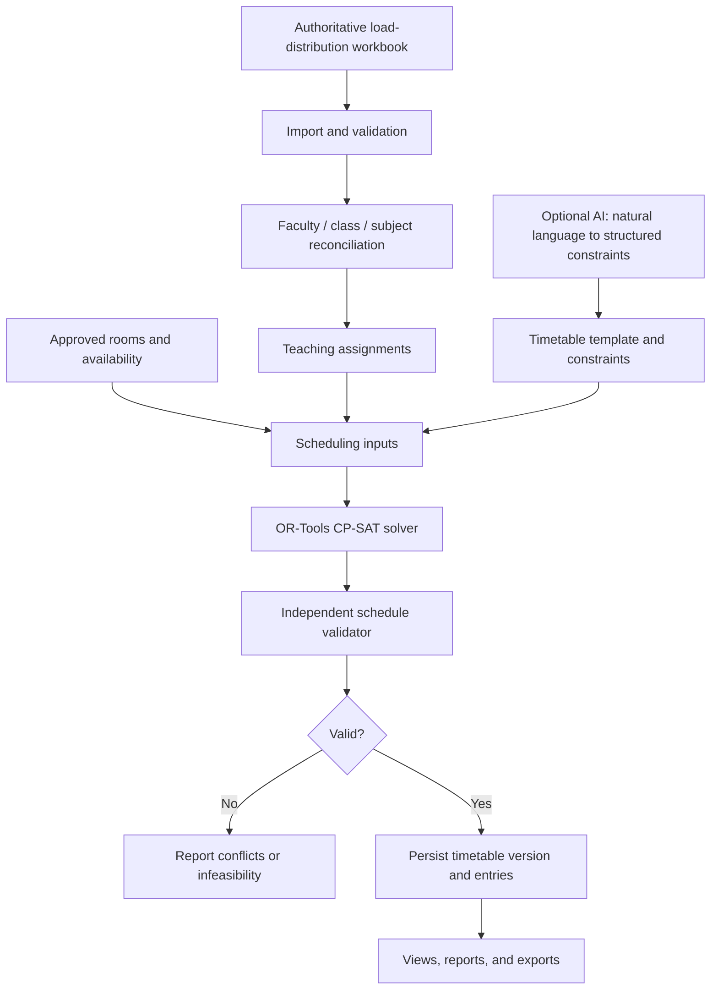

# Slotify

**Academic timetable planning built around real workload data and constraint optimization.**

Slotify is an academic timetable-management platform for the Electronics & Telecommunication (E&TC) department. It is designed to bring academic load distribution, faculty and class assignments, room resources, timetable generation, validation, and exports into one workflow.

> **Development status:** Slotify is under active development. A successful frontend build does not by itself mean the database schema, source data, or end-to-end timetable-generation workflow is ready. Use verified institutional data, and confirm migrations, validation, and persistence before relying on a generated timetable.

## Contents

- [What Slotify does](#what-slotify-does)
- [Architecture](#architecture)
- [Scheduling workflow](#scheduling-workflow)
- [Technology stack](#technology-stack)
- [Repository layout](#repository-layout)
- [Requirements](#requirements)
- [Run with Docker Compose](#run-with-docker-compose)
- [Run frontend and backend separately](#run-frontend-and-backend-separately)
- [Database setup and migrations](#database-setup-and-migrations)
- [Local development without the login page](#local-development-without-the-login-page)
- [Administrator provisioning](#administrator-provisioning)
- [Real data and import integrity](#real-data-and-import-integrity)
- [Testing and quality checks](#testing-and-quality-checks)
- [Troubleshooting](#troubleshooting)
- [Security](#security)
- [Development principles](#development-principles)
- [Contributing](#contributing)
- [License](#license)

## What Slotify does

Slotify is intended to support the following academic planning workflow:

- **Load distribution:** import teaching assignments from an authoritative Excel workbook and validate the records.
- **Master-data reconciliation:** map faculty, sections/classes, subjects, and other source values to approved application records.
- **Resource planning:** maintain rooms/labs, availability, capacity, and any relevant equipment or scheduling restrictions.
- **Constraint-based timetable generation:** use Google OR-Tools CP-SAT to find a schedule that satisfies the configured hard constraints and optimizes supported preferences.
- **Independent validation:** check a candidate schedule separately from the solver before treating it as valid.
- **Persistence and review:** store timetable versions and entries so results can be retrieved and audited.
- **Reporting and export:** make timetable and validation results available for review and supported exports.
- **Natural-language constraint interpretation:** use the separate AI module to convert user requirements into structured constraints. The AI module does **not** generate timetables directly.

Availability and completeness of individual workflows depend on the current implementation, valid database schema, approved input data, and configured environment.

## Architecture



### Main components

| Component | Responsibility |
|---|---|
| React + TypeScript + Vite | User interface and client-side navigation |
| FastAPI | Application API and server-side workflows |
| PostgreSQL | Persistent application data, workload, resources, and timetable records |
| Google OR-Tools CP-SAT | Constraint-based scheduling and optimization |
| Redis | Caching and job-related infrastructure where configured |
| openpyxl | Excel workbook import/export workflows |
| Separate AI module | Natural language to structured scheduling constraints; not timetable generation |

## Scheduling workflow

1. Import the authoritative load-distribution workbook.
2. Validate source rows and review unresolved faculty, class/section, and subject mappings.
3. Approve and persist teaching assignments for the intended academic term.
4. Register approved resources and their verified availability, capacity, and restrictions.
5. Select the timetable template and scheduling constraints.
6. Submit the scheduling inputs to the OR-Tools CP-SAT solver.
7. Validate the proposed schedule independently of the solver.
8. Persist a timetable version and its entries only after the applicable validation succeeds.
9. Retrieve, inspect, validate, and export the persisted result.

The application should not silently invent missing assignments or resource details. An unresolved mapping, unavailable database, infeasible constraint set, or failed validation must be reported as a blocker—not replaced by fabricated data.

## Technology stack

- **Frontend:** React, TypeScript, Vite
- **Backend:** Python, FastAPI
- **Database:** PostgreSQL
- **Optimization:** Google OR-Tools CP-SAT
- **Cache / jobs:** Redis
- **Excel:** openpyxl
- **AI:** separate natural-language constraint interpretation module

The project is organized as a modular monorepo, not a microservices architecture.

## Repository layout

```text
Slotify/
├── backend/       # FastAPI application, database models, migrations, scheduler
├── frontend/      # React + TypeScript + Vite application
├── ai/            # Natural-language constraint interpretation module
├── data/          # Source, processed, template, and sample data as available
├── docs/          # Project and operational documentation
├── scripts/       # Import, verification, and operational scripts
├── tests/         # Test suites
├── outputs/       # Generated reports and outputs; inspect before sharing
├── .github/       # CI/CD workflows
├── compose.yaml   # Docker Compose configuration, if present under this name
└── README.md
```

File names can differ slightly in the current checkout. Use the actual files present in the repository as the source of truth.

## Requirements

For the Docker-based development workflow:

- Docker Desktop (or a compatible Docker Engine)
- Docker Compose v2

For running services separately:

- A Python version supported by `backend/requirements.txt`
- A Node.js version supported by the frontend package configuration
- PostgreSQL
- Redis, if required by the selected backend workflows

Check the repository's package and dependency files for exact supported versions rather than guessing.

## Run with Docker Compose

From the repository root:

```bash
docker compose config --services
docker compose up --build
```

The first command lists the Compose services configured in the current checkout. The second builds and starts the configured development stack.

Open the frontend URL printed by Vite or configured in the Compose file. In the documented local setup, this is commonly `http://localhost:5173`; confirm the actual port if the configuration differs.

To stop the stack without deleting persistent volumes:

```bash
docker compose down
```

Do **not** append `-v` unless you intentionally want to remove persistent volumes. Never remove database volumes as a troubleshooting shortcut.

The development Compose configuration is intended to enable a local-only authentication bypass while keeping the real API, database, load-distribution workflow, and solver path. Verify the current Compose configuration before relying on those settings.

## Run frontend and backend separately

Use two terminals. PostgreSQL and Redis must already be running and the backend must have a valid local environment configuration.

### 1. Configure the backend

Review the backend environment/settings code and any available example environment files. Create a local, ignored environment file for your machine and configure the database URL and any required Redis or application settings. Never put real secrets in source control.

Create and activate a Python virtual environment:

```bash
cd backend
python3 -m venv .venv
source .venv/bin/activate
pip install -r requirements.txt
```

After the database schema has been initialized and the backend environment is correct, start FastAPI:

```bash
uvicorn app.main:app --reload
```

Run the command from the `backend/` directory, where `app.main:app` is importable.

### 2. Configure and start the frontend

In a second terminal:

```bash
cd frontend
npm install
VITE_AUTH_DISABLED=true VITE_DEMO_MODE=false npm run dev
```

This enables the documented local frontend auth bypass while keeping demo fixtures disabled for this process. The backend must independently be configured for the intended local-development auth behavior. If the frontend port is already in use, Vite may choose another port; use the URL printed in the terminal.

For persistent local settings, use a local ignored Vite environment file such as `.env.local` with:

```dotenv
VITE_AUTH_DISABLED=true
VITE_DEMO_MODE=false
```

Vite environment variables prefixed with `VITE_` are bundled for client-side use. Never put passwords, private keys, or server-only secrets in frontend environment variables.

## Database setup and migrations

Slotify uses Alembic migrations in `backend/alembic/` to manage the PostgreSQL schema.

For a **new or verified empty development database**, configure the backend's `DATABASE_URL` and run the migration command from the backend directory:

```bash
cd backend
alembic upgrade head
```

Then verify that the expected application tables exist. A migration command returning successfully—or a row in `alembic_version`—does not by itself prove that the complete application schema exists.

### Existing database with a missing schema

If `alembic_version` says the database is up to date but tables such as `users`, `permissions`, `resources`, or `teaching_assignments` are missing, **stop before running more migrations or changing the recorded revision**. This indicates the recorded migration state and actual schema may be inconsistent.

Safe recovery procedure:

1. Back up the existing database and verify the backup file.
2. Inspect the migration dependency chain and the current models.
3. Test the complete migration chain against a separate, disposable recovery database.
4. Verify all required tables, columns, constraints, and indexes in that isolated database.
5. Plan the repair or replacement of the broken local development database only after understanding what data can be preserved.

Do not blindly run `alembic stamp`, delete tables, drop a database, remove Docker volumes, or assume `alembic upgrade head` will recreate tables when the database already records the latest revision.

## Local development without the login page

Slotify supports a development-only authentication bypass. It is intended to make local UI and workflow development easier; it is not a production authentication strategy.

- `VITE_AUTH_DISABLED=true` controls the frontend's local auth-bypass behavior.
- `LOCAL_AUTH_DISABLED=true` controls the backend behavior and is intended to be accepted only when `APP_ENV=development`.
- `VITE_DEMO_MODE=false` keeps the frontend on the real API path rather than serving demo fixtures.

The frontend bypass and backend bypass are separate settings. Configure and verify both for the chosen workflow.

The bypass does **not** create database users or application records. Backend operations that reference an active user for audit, notification, or timetable-version relationships can still require an actual user row and a migrated schema. A working bypass does not prove database-backed timetable generation works.

Do not enable authentication bypass in production. The production Compose overlay should keep authentication enabled.

## Administrator provisioning

The seed script deliberately has no hard-coded default administrator password. An administrator is provisioned only when both `SEED_ADMIN_EMAIL` and `SEED_ADMIN_PASSWORD` are explicitly supplied to the backend seed process.

Before provisioning an administrator:

1. Verify the application schema is complete and current.
2. Use a unique administrator email and a strong password that meets the current password policy (the current project policy has required at least 12 characters).
3. Supply credentials through the intended local environment or secret-management mechanism; do not commit them to source control.
4. Run the seed command only against the intended, verified database.

From `backend/`, the project seed module is:

```bash
python -m app.database.seed
```

The command relies on the environment variables above being available to the process. Do not run it against a database that is missing application tables; fix and verify the schema first. Do not use credentials embedded in integration-test scripts to sign into the application.

## Real data and import integrity

Real timetable generation depends on authoritative and approved academic data. Before generating a timetable, verify that:

- The source workbook is the intended authoritative version for the selected academic term.
- Faculty identities and class/section mappings are resolved or explicitly marked as pending.
- Subject and teaching-assignment records are traceable to the source.
- Theory, practical, tutorial, and project hours preserve the meanings used by the source and backend schema.
- Room capacity, availability, equipment, and permitted scheduling use are verified rather than guessed.
- Unresolved source rows and zero-load records have an explicit review outcome.
- The scheduler's input set corresponds to approved, persisted records.

A room-directory photograph can establish room labels, but it does not establish capacity, availability, equipment, or scheduling suitability. Unknown values should remain pending confirmation and must not be treated as verified inputs to the solver.

Keep source workbooks and generated reconciliation reports under appropriate access controls. Review files in `data/` and `outputs/` before committing or sharing them; they may contain private institutional information.

## Testing and quality checks

Use the tooling and scripts available in the current checkout. Typical frontend checks are:

```bash
cd frontend
npm run build
npm test -- --run
npm run lint
```

Script names can vary; inspect `frontend/package.json` and use the scripts actually defined there. Run backend tests from the backend's documented environment, using an isolated test database or the test configuration. Never run destructive tests against the application database.

A useful verification sequence is:

1. TypeScript and lint checks pass.
2. Frontend production build succeeds.
3. Relevant unit and integration tests pass.
4. The frontend visibly renders when API requests fail and presents a meaningful error state.
5. Real workload imports can be traced to source records.
6. The solver consumes approved persisted inputs.
7. Independent validation checks the candidate timetable.
8. The saved timetable can be reloaded and reconciled against required teaching hours and constraints.

A green frontend build is not evidence of database integrity or end-to-end timetable-generation correctness.

## Troubleshooting

### The dashboard is blank

A blank page is not an acceptable API error state. Inspect the browser console and failed network requests, then check the route, React providers, layout, theme initialization, and dashboard component. Backend failures should be displayed as clear loading/error states while the application shell remains visible.

### Login is rejected

Check whether the local frontend and backend auth-bypass settings match the intended workflow. If using normal authentication, verify that the application schema exists, the administrator row is present and active, and the password is the one provisioned for that account. Do not guess credentials from test scripts.

### The database contains only `alembic_version`

The database is not ready for normal application operations. Back it up, inspect the actual migration chain, test migrations against an isolated database, and plan recovery. Do not blindly rerun migrations or stamp the current revision.

### The API starts but application pages are empty

A reachable API or health endpoint does not prove that application tables and data exist. Inspect API responses, database tables, backend logs, and the selected term's persisted source data. Do not replace failures with fabricated data.

### Timetable generation fails

Check input completeness, approved mappings, resource constraints, backend worker status, solver status, and independent validation output. If the problem is infeasibility or missing data, report the actual blockers rather than displaying a fabricated timetable.

### Docker services are unavailable

Start Docker Desktop, then check the configured service names and status:

```bash
docker compose config --services
docker compose ps
```

Use logs for the specific failing service:

```bash
docker compose logs --tail=150 <service-name>
```

Replace `<service-name>` with a service name reported by Compose. Do not type the angle-bracket placeholder literally, and do not remove volumes to try to fix service startup.

## Security

- Never commit `.env` files, real API keys, passwords, access tokens, private keys, or database dumps.
- Keep local environment files ignored by Git; commit example files only when all values are safe placeholders.
- Do not expose institutional, faculty, or student data in public repositories, screenshots, test fixtures, or generated outputs without authorization.
- Keep production authentication and authorization enabled.
- Restrict local auth bypass to local development.
- Use separate databases for tests and recovery experiments.
- Back up databases before recovery operations and verify the backups.
- Do not use destructive database commands as routine troubleshooting steps.

## Development principles

- **Modular monorepo:** keep the project organized without splitting it into microservices.
- **Solver owns scheduling:** AI translates natural-language requests into structured constraints; OR-Tools CP-SAT handles timetable optimization.
- **One timetable-entry source of truth:** keep persisted timetable entries authoritative for views and exports.
- **Centralized scheduling logic:** scheduling logic stays in `backend/app/scheduler/`.
- **Independent validation:** validate solver output separately before accepting or publishing it.
- **Migrations manage schema:** schema changes are versioned and verified using Alembic.
- **Configuration via environment:** secrets and environment-specific settings are not hard-coded.
- **No fabricated academic data:** unresolved or missing source data remains visibly unresolved.

## Contributing

1. Inspect the existing implementation and current Git changes before editing.
2. Keep changes focused and preserve unrelated work.
3. Add or update tests for behavior changes.
4. Run relevant type, lint, test, and build checks.
5. Do not include secrets or private institutional data in a pull request.
6. Explain any migrations, environment variables, or manual verification required.

## License

This project is licensed under the MIT License. See [`LICENSE`](LICENSE) for the full license text.
